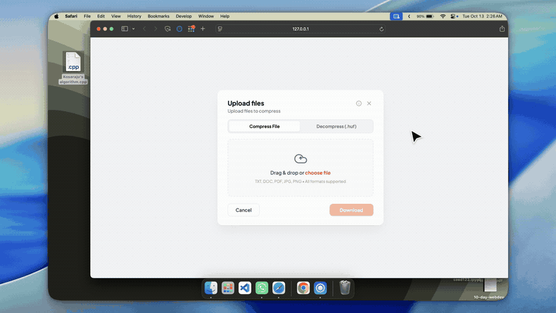

# Huffman-File-Zipper

> A lossless file compression and decompression tool built with C++ and Huffman Coding, featuring an interactive web interface.

[](https://isocpp.org/)
[](LICENSE)
[](https://en.wikipedia.org/wiki/Huffman_coding)

---

## 🎥 Live Demo

<p align="center">
  <a href="#huffman-file-zipper">
    
  </a>
</p>

---

## 📌 Overview

**Huffman-File-Zipper** is an implementation of **Huffman Coding**, a greedy, bottom-up lossless data compression algorithm. 

The project consists of:
1. **Core C++ Engine**: High-performance command-line tool with bit-level encoding/decoding and min-heap prefix tree construction.
2. **Interactive Web Interface**: A modern in-browser compressor/decompressor with drag-and-drop file upload, live compression metrics, and tab state preservation.

---

## ⚡ How It Works (Core DSA Workflow)

The compressor relies on variable-length prefix coding where more frequently occurring characters get shorter bit codes, and rarer characters get longer bit codes.

```
Input File ──► Frequency Table ──► Min-Heap (Priority Queue) ──► Huffman Tree ──► Bitwise Codebook ──► .huf Compressed File
```

### 1. Compression Workflow (`compress()`)

* **`createArr()`**: Initializes the symbol array and resets frequencies.
* **`createMinHeap()`**: Reads the input file, counts the frequency of each character, and inserts them into a min-heap (`std::priority_queue`).
* **`createTree()`**: Greedily extracts the two nodes with the lowest frequencies, creates a parent node whose frequency is the sum of both, and re-inserts it into the min-heap until only the root node remains.
* **`createCodes()` & `traverse()`**: Performs tree traversal from the root, assigning `'0'` for left branches and `'1'` for right branches to generate optimal prefix codes.
* **`binToDec()` & `decToBin()`**: Converts between variable-length binary strings and compact 8-bit bytes.
* **`saveEncodedFile()`**: Writes the header (serialized Huffman tree metadata) followed by bit-packed encoded data, padding the final byte with trailing zeros and recording the padding count.

### 2. Decompression Workflow (`decompress()`)

* **`getTree()` & `buildTree()`**: Reads the header from the `.huf` file and reconstructs the binary prefix tree.
* **`saveDecodedFile()`**: Reads encoded byte segments, converts them to binary, traverses the tree bit-by-bit from the root to leaf nodes, and writes out the original restored characters.

---

## 🚀 Getting Started (CLI)

### Compilation

Compile both encoder and decoder using any modern C++ compiler:

```bash
clang++ -std=c++11 encode.cpp huffman.cpp -o encode
clang++ -std=c++11 decode.cpp huffman.cpp -o decode
```

### Usage

#### 1. Compress a File
```bash
./encode inputFile.txt compressedFile.huf
```

#### 2. Decompress a File
```bash
./decode compressedFile.huf outputFile.txt
```

#### 3. Verify Lossless Integrity
```bash
diff -q inputFile.txt outputFile.txt
# No differences reported — files are 100% bit-for-bit identical!
```

---

## 📊 Performance & Compression Ratio

Tested on sample text data (`inputFile.txt`):

| File | Size | Description | Ratio |
| :--- | :--- | :--- | :--- |
| `inputFile.txt` | **2.16 MB** | Original uncompressed text file | Baseline |
| `compressedFile.huf` | **1.14 MB** | Huffman compressed binary | **~48% Reduction** |
| `outputFile.txt` | **2.16 MB** | Decompressed output file | **100% Lossless** |

---

## 🌐 Web Interface

The project includes an interactive web application that runs universal Huffman compression client-side in the browser.

### Running the Web App Locally:
```bash
python3 -m http.server 3000
```
Open **[http://localhost:3000](http://localhost:3000)** in your browser.

**Features:**
* Drag-and-drop file upload.
* Instant compression and decompression.
* Live file size comparison and savings ratio badge.
* Preserves uploaded files and state across tab switches.

---

## 📂 Project Structure

```
Huffman-File-Zipper/
├── encode.cpp       # CLI encoder entry point
├── decode.cpp       # CLI decoder entry point
├── huffman.hpp      # Header file containing class definitions & method prototypes
├── huffman.cpp      # Implementation of Huffman tree and bit-packing methods
├── index.html       # Web UI layout
├── styles.css       # Clean, modern UI styling
├── app.js           # Client-side Huffman engine & UI controller
├── inputFile.txt    # Sample benchmark test file
├── .gitignore       # Git ignore rules for build artifacts
└── README.md        # Project documentation
```
